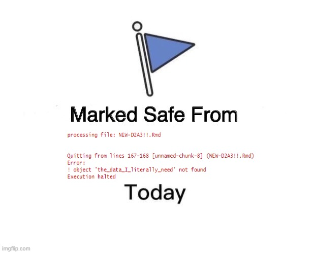
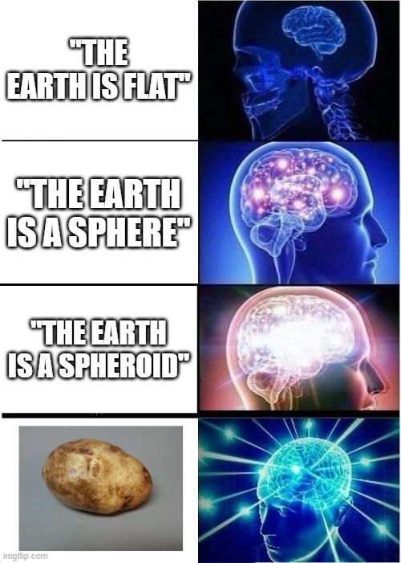
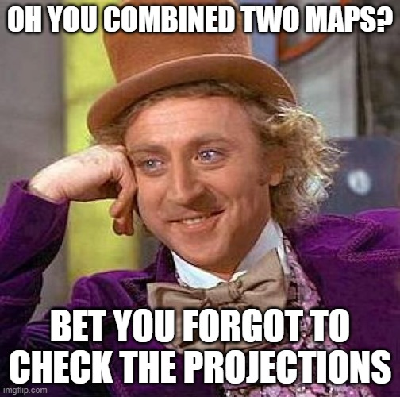
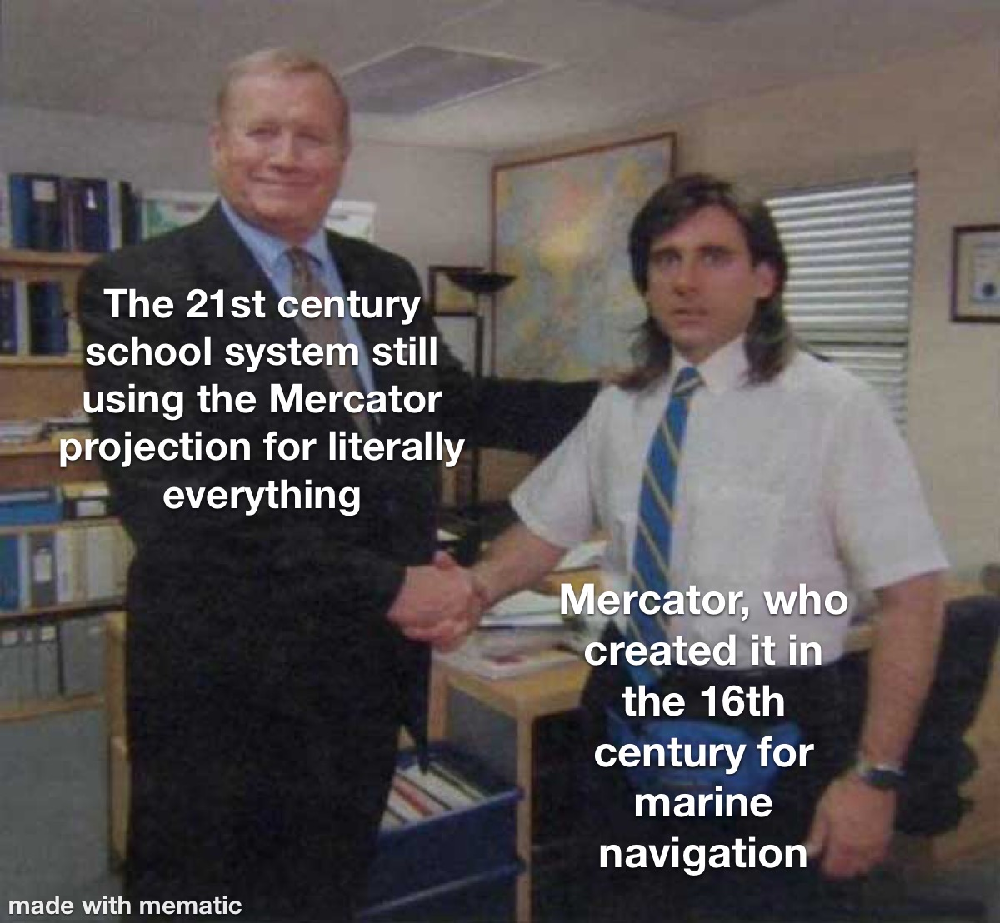
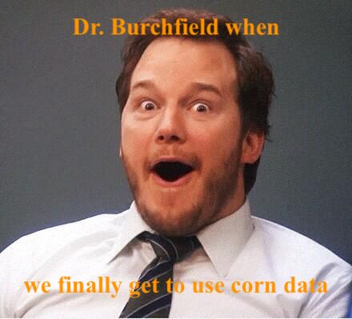

Every year in Environmental Data Science, a brave group of undergraduates submits memes sharing their love of (fear of?) the R programming language. I am honored to be able to share these rare pieces of art with you now:

